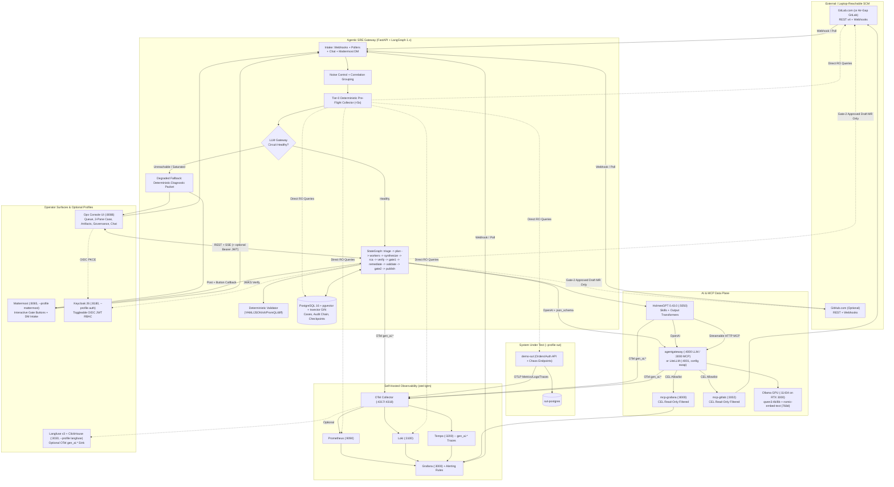

# Agentic SRE & Platform Engineering System -- Architecture & Component Design Specification (v2.0 Air-Gap & Local-GPU Stack)

> **Status:** Approved Architecture & Implementation Contract
> **Date:** 2026-11-27
> **Target Consumer:** Any AI Coding Agent, Multi-Agent Orchestrator, or Human Engineer
> **Supersedes / Extends:** Extends [`2026-07-11-agentic-sre-team-design.md`](2026-07-11-agentic-sre-team-design.md) (Phases 0-6 baseline) with the locked decisions from [`docs/2026-11-research-and-architecture-review.md`](../../../../docs/2026-11-research-and-architecture-review.md).
> **Companion Specs:**
> - Infrastructure & Compose Spec: [`2026-11-27-docker-compose-stack-spec.md`](2026-11-27-docker-compose-stack-spec.md)
> - Phased Implementation Plan: [`../plans/2026-11-27-airgap-compose-implementation-plan.md`](../plans/2026-11-27-airgap-compose-implementation-plan.md)

---

## 1. Mission, Non-Negotiable Constraints, and Design Laws

### 1.1 Mission
Deliver a production-grade, self-hosted **Agentic SRE & DevSecOps Platform** running end-to-end via Docker Compose on the operator's Windows workstation (and portable via config-only swap to a multi-GPU air-gapped Kubernetes/OpenShift cluster). The platform handles three operator loops through one governed control plane:

1. **Incident Triage, RCA & Runbook Drafting (`kind = "incident"`):** Ingests observability alerts (self-hosted Grafana LGTM webhook + poller) and human chat reports (Mattermost DM, Ops Console Chat, opt-in Telegram), executes Tier-0 deterministic golden-signal pre-collection in under 5 seconds, runs parallel hypothesis-driven evidence workers via HolmesGPT 0.43.x and `agentgateway`-filtered read-only MCP servers, verifies every claim citation, gates human approval at RCA (Gate 1) and Runbook (Gate 2), validates drafted commands/YAML/PromQL deterministically, and distills closed-case learnings.
2. **CI/CD Pipeline Failure Diagnostics & Patch Drafting (`kind = "pipeline_failure"`):** Ingests failed pipelines from **GitLab (`gitlab.com` on this laptop; self-hosted GitLab in air-gap via `SRE_GITLAB_BASE_URL`)** and **GitHub Actions** via signature-verified webhooks and pollers, classifies failures (`code`, `test`, `config`, `dependency`, `infra_runner`, `flaky`, `permissions`), investigates failed job logs + CI YAML + triggering diffs via `ci` and `changes` workers, drafts concrete file patches with deterministic unified diffs, validates syntax, and optionally opens a **draft MR/PR** (never merged) after Gate-2 human approval.
3. **Interactive Ops Console Chat ("Ask the Team"):** Provides persisted, read-only, budget-capped Q&A threads (ad-hoc environment queries, case-grounded Q&A, and preview-then-confirm promotion into a full gated case).

### 1.2 Hard Constraints (Invariants -- Never Violate)
1. **Zero Cloud LLM or SaaS Observability Dependency:** Zero runtime calls to Vertex AI, AWS Bedrock, OpenAI, Anthropic, Grafana Cloud, or LangSmith Cloud in `local-gpu` and `airgap` profiles. (`gitlab.com` REST/MCP is explicitly permitted for SCM/CI testing on this laptop via `SRE_GITLAB_BASE_URL=https://gitlab.com`.)
2. **OSS Self-Hosted Models Only -- Zero Workflow Degradation:** All LLM and embedding calls run locally on open-weight Apache-2.0/MIT models. Reliability matches or exceeds cloud setups through six deterministic scaffolding layers:
   - **Law 1 (Tier-0 Pre-Flight + Degraded Fallback):** Gather golden signals deterministically before any LLM call; emit an actionable **Deterministic Diagnostic Packet** if inference is down or saturated.
   - **Law 2 (Grammar-Constrained Decoding):** Use native `response_format={"type": "json_schema", ...}` (Ollama GBNF / vLLM XGrammar) plus `<think>...</think>` extraction before JSON parsing.
   - **Law 3 (Narrow Read-Only Tool Scoping):** Enforce CEL per-tool allowlists in `agentgateway` so MCP write tools are stripped from `tools/list` and blocked on `tools/call`.
   - **Law 4 (Salient Evidence Extraction):** Replace blind `[:300]`/`[:200]` head slicing with head + tail + error-line extraction so stack traces and exit codes survive into synthesis, RCA, citation verification, and remediation.
   - **Law 5 (Hybrid Retrieval with Fallback):** Combine `pgvector` cosine similarity and PostgreSQL `tsvector` BM25 via Reciprocal Rank Fusion (RRF) with relevance thresholds and automatic BM25-only fallback if embeddings fail.
   - **Law 6 (Deterministic Pre-Gate Validation):** Validate drafted YAML, JSON, shell snippets, PromQL expressions, K8s manifests, and file patches deterministically with one bounded self-repair loop before human Gate-2 review.
3. **Human-in-Command (Strictly Read-Only Agents):** Zero write tools exist in `TOOL_REGISTRY` or in `agentgateway` MCP allowlists. Agents never mutate infrastructure. The sole write capability in the system (`publish_draft_change`) executes inside the Python gateway *only* after human Gate-2 approval when `SRE_SCM_DRAFT_MR=true`, using a dedicated publish token, opening a **draft** MR/PR and never merging.
4. **Deterministic Offline Test Harness Preservation:** Every change MUST preserve `pytest` (119+ gateway tests), `npm test` (10+ UI tests), `make smoke` (`--profile fake`), and `make e2e` (`--profile fake --profile ui`) with zero external network calls and zero lint/type warnings.

---

## 2. Target Laptop Hardware Ground Truth & Resource Budget

### 2.1 Verified Hardware Telemetry (Probed Directly on Target Host)

| Resource | Measured Ground Truth on This Laptop | Architectural Consequence |
|---|---|---|
| **OS & Container Runtime** | Windows 10/11 (`10.0.26300`, `AMD64`), WSL2, Docker Engine `29.5.3` (`docker.exe` + `docker-compose.exe`) | Volume mounts MUST be Windows-safe (never mount `/dev/null`; use named volumes or repo config files). Shell scripts inside containers MUST have `LF` line endings enforced via `.gitattributes`. |
| **CPU** | 12 logical processors (`x86_64`) | Keep heavy CPU services bounded; avoid spawning >4 concurrent LLM requests on local laptop (`OLLAMA_NUM_PARALLEL=2`). |
| **System RAM** | **63.8 GB physical RAM** (~33.0 GB free alongside Windows + IDE + browser) | Total Docker Compose footprint must stay under **8-12 GB RAM** in standard `local-gpu` mode (and under **18 GB** even with optional `auth` + `mattermost` + `langfuse` profiles enabled). |
| **GPU (Critical Correction)** | **NVIDIA Quadro RTX 3000 Mobile** -- Turing `TU106` (`sm_75`, Compute Capability 7.5), **6144 MiB (6.0 GB) dedicated GDDR6 VRAM**, 35W Max-Q TGP, Driver `596.71`, CUDA `13.2` | Earlier notes cited "54 GB total GPU memory" from Windows Task Manager (`6 GB dedicated GDDR6 + ~48 GB WDDM shared system RAM`). **Only 6144 MiB is fast dedicated GDDR6 VRAM**, and Turing `sm_75` supports FP16/INT8/INT4 (no native BF16 or FP8 tensor cores). |
| **Disk** | **201.0 GB free** on workspace drive `C:` | Ample space for OCI images (~12 GB), Ollama GGUF weights (~6-22 GB), Postgres, and LGTM volumes. |

### 2.2 Local-GPU Inference Strategy (Zero VRAM Swap Thrashing)

On a **6 GB dedicated VRAM** Turing GPU, assigning *different* multi-gigabyte models to `small`, `medium`, `frontier`, and `embeddings` causes Ollama to unload and reload weights across PCIe 7+ times per incident case, adding 45-90 seconds of pure swap latency and thrashing KV cache.

To achieve fast (**35-75 tok/s**), zero-swap local execution while keeping `config/models.airgap.yaml` multi-tier for production GPU clusters:

1. **Default `local-gpu` Profile (`config/models.local-gpu.yaml` -- Recommended 100% Dedicated VRAM Fit):**
   - **Unified Chat/Reasoning Model across `small`, `medium`, `frontier`:** `qwen3:8b` (`Q4_K_M`, ~5.0 GB) OR `qwen3:4b` (`Q4_K_M`, ~2.6 GB, ultra-fast laptop mode via `SRE_LOCAL_CHAT_MODEL=qwen3:4b`).
   - **Embedding Model (`768` native dimensions):** `nomic-embed-text` (`v1.5`, Apache 2.0, **274 MB**, native `768` dimensions -- exact match for `EMBED_DIM = 768` in `db/models.py` without Matryoshka truncation).
   - **VRAM Footprint (`qwen3:4b` + `nomic-embed-text` + 16k Q8_0 KV cache):** `2.6 GB + 0.3 GB + 0.9 GB = 3.8 GB / 6.0 GB VRAM` -- **100% resident in GDDR6 simultaneously** (`OLLAMA_MAX_LOADED_MODELS=2`, `OLLAMA_KEEP_ALIVE=-1`, `OLLAMA_KV_CACHE_TYPE=q8_0`, `OLLAMA_FLASH_ATTENTION=1`). Zero model swaps, warm prefix cache across every LangGraph node, ~60+ tok/s.
   - **High-Capability Option (`qwen3:8b`):** `5.0 GB + 0.3 GB + 0.6 GB (8k Q8_0 KV) = 5.9 GB` (~95-100% in VRAM, ~32-40 tok/s). Default `SRE_LOCAL_CHAT_MODEL=qwen3:4b` for snappy multi-worker parallel fan-out on 6 GB VRAM, with one-variable upgrade `SRE_LOCAL_CHAT_MODEL=qwen3:8b` or `qwen3:30b-a3b` (MoE 3B active using ~19 GB system RAM + 5 GB VRAM at ~14-20 tok/s).
2. **Production `airgap` Profile (`config/models.airgap.yaml` -- Multi-GPU `llm-d` + `vLLM` Cluster):**
   - `small`: `Qwen/Qwen3.6-35B-A3B` (MoE, 3B active)
   - `medium`: `Qwen/Qwen3.6-27B`
   - `frontier`: `deepseek-ai/DeepSeek-V4` (or `Qwen/Qwen3.6-27B` on 2-GPU deployments)
   - `embeddings`: `Qwen/Qwen3-Embedding-4B` (`dim: 768`, `send_dimensions: true`)

### 2.3 Container RAM & VRAM Budget on This Laptop

| Service | Compose Profile | Container Memory Limit | Steady-State RAM | GPU VRAM |
|---|---|---|---|---|
| `postgres` (`pgvector:pg16`) | core (always) | `1024m` | ~160 MB | 0 |
| `gateway` (FastAPI + LangGraph) | core (always) | `1024m` | ~280 MB | 0 |
| `ui` (nginx + React 19 SPA) | `ui` | `256m` | ~30 MB | 0 |
| `ollama` (GGUF CUDA server) | `local-gpu` | `8192m` (24g if MoE) | ~1.2 GB | **3.8 - 5.8 GB** |
| `agentgateway` (Rust LLM+MCP) | `local-gpu` | `512m` | ~45 MB | 0 |
| `lgtm` (`grafana/otel-lgtm`) | `local-gpu` | `2048m` | ~750 MB | 0 |
| `mcp-grafana` (`grafana/mcp-grafana`) | `local-gpu` | `256m` | ~35 MB | 0 |
| `mcp-gitlab` (`zereight050/gitlab-mcp`) | `local-gpu` | `512m` | ~90 MB | 0 |
| `holmes` (`robustadev/holmes:0.43.0`) | `local-gpu` | `1536m` | ~380 MB | 0 |
| `demo-sut` + `sut-db` | `sut` | `768m` | ~220 MB | 0 |
| **Core Stack Subtotal** | `local-gpu + ui + sut` | -- | **~3.2 GB RAM** | **~3.8 - 5.8 GB VRAM** |
| `litellm` (alt LLM gateway) | `litellm` (opt-in) | `768m` | ~280 MB | 0 |
| `mattermost` | `mattermost` (opt-in) | `1024m` | ~350 MB | 0 |
| `keycloak` (`keycloak:26`) | `auth` (opt-in) | `1024m` (`-Xmx512m`) | ~580 MB | 0 |
| `langfuse-web` + `worker` + `clickhouse` + `redis` + `minio` | `langfuse` (opt-in) | `4096m` combined | ~2.6 GB | 0 |
| **Full All-Profiles Peak** | all profiles on | -- | **~7.0 GB RAM** | **~3.8 - 5.8 GB VRAM** |

---

## 3. End-to-End Architecture & Data Flows



---

## 4. Updated Case `StateGraph` Specification

### 4.1 Graph Topology (`gateway/src/sre_gateway/graph/build.py`)

```
START
  |
  v
[preflight]  (Tier-0 deterministic golden-signal collector + LLM circuit check; guarded)
  |-- if halt -> [park] -> END
  |-- if llm_unavailable -> writes diagnostic_packet artifact -> [park] -> END
  v
[triage]     (small tier; hybrid runbooks + learnings + preflight summary; guarded)
  |-- if halt -> [park] -> END
  |-- if non_incident -> END
  v
[plan]       (deterministic round increment + worker selection; guarded)
  |-- Send fan-out (metrics, logs, infra, changes | ci, changes [+ infra])
  v
[workers]    (parallel HolmesGPT 0.43 calls w/ injected skills + preflight context)
  |
  v
[synthesize] (medium/frontier tier; updates Hypothesis board; max 2 rounds; guarded)
  |-- if halt -> [park] -> END
  |-- if need_more and round < 2 -> [plan]
  v
[rca]        (frontier tier; drafts RcaOut with [E#]/[PF#] citations; guarded)
  |
  v
[verify_citations] (deterministic EID/PFID check + small-tier entailment; guarded)
  |-- if halt -> [park] -> END
  |-- if not verified and not repair_used -> [rca]  (max 1 repair loop)
  v
[gate_rca]   (HITL Gate 1 via interrupt(); excludes wait time from wall-clock budget)
  |-- if reject -> [rca] (resets verification & repair_used)
  |-- if approve / approve_with_edits -> [remediate]
  v
[remediate]  (frontier tier; drafts RunbookOut + patch_files + deterministic patch_diffs; guarded)
  |-- if halt -> [park] -> END
  v
[validate_remediation] (deterministic YAML/JSON/sh/PromQL/diff validator; guarded)
  |-- if halt -> [park] -> END
  |-- if not valid and not runbook_repair_used -> [remediate]  (max 1 repair loop)
  v
[gate_runbook] (HITL Gate 2 via interrupt(); idempotent Approval upsert)
  |-- if reject -> [remediate] (resets runbook_validation & runbook_repair_used)
  |-- if approve / approve_with_edits -> [publish]
  v
[publish]    (indexes runbook + distills learning + posts artifacts + optional draft MR; guarded)
  |
  v
END
```

### 4.2 Extended `CaseState` Contract (`graph/state.py`)

Add the following fields to `CaseState` (all `total=False` for checkpoint backward compatibility):

```python
class CaseState(TypedDict, total=False):
    # --- existing fields (unchanged) ---
    case_id: str
    display_id: str
    kind: str
    title: str
    severity: int
    effort: str
    round: int
    failure_class: str | None
    non_incident: bool
    hypotheses: list[dict]
    evidence: Annotated[list[dict], operator.add]
    worker_reports: Annotated[list[dict], operator.add]
    context_notes: Annotated[list[str], operator.add]
    query_hints: list[str]
    need_more: bool
    rca: dict | None
    verification: dict | None
    repair_used: bool
    runbook: dict | None
    gate_rca: dict | None
    gate_runbook: dict | None
    halt: dict | None
    # --- new v2.0 fields ---
    preflight: dict | None                 # {summary_md, pf_eids, matched_runbooks, matched_learnings, llm_available}
    matched_runbooks: list[dict]           # [{id, title, body_excerpt, score}] passed into triage AND workers
    runbook_validation: dict | None        # {valid: bool, checks_run: int, errors: [{target, check, detail}]}
    runbook_repair_used: bool              # bounds validate_remediation -> remediate repair to 1 pass
```

### 4.3 Critical Evidence ID Namespace Invariant (`PF1..PFk` vs `E1..En`)

- **Worker Evidence (`E1..En`):** Continues to allocate exclusively from `cases.evidence_counter` inside `graph/nodes/workers.py`.
- **Pre-Flight Evidence (`PF1..PFk`):** Deterministic pre-flight probes write `EvidenceRow` records with `eid = "PF1"`, `"PF2"`, ... (`worker = "preflight"`). They **never** increment `cases.evidence_counter`.
- **Fake-Profile Compatibility Rule:** When `settings.preflight_probes_enabled` is `False` (default in unit tests and `--profile fake` where no live Prometheus/Loki/SUT endpoints are configured), `preflight` executes local DB hybrid retrieval (`matched_runbooks`, `matched_learnings`), checks LLM availability (`ScriptedChatModel` is always available), writes **zero** `EvidenceRow` rows, and forwards cleanly to `triage`. This guarantees `test_graph_incident.py` (`assert len(evidence) == 16` and scripted `E1`/`E2` citations), `make smoke`, and `make e2e` pass without fixture breakage, while live `local-gpu` and `airgap` runs populate `PF1..PFk` golden-signal receipts citable alongside `E1..En`.

---

## 5. OSS LLM Harness, Constrained Decoding & Model Profiles

### 5.1 Profile Resolution & Environment Interpolation (`settings.py` & `llm/factory.py`)

1. **`Settings.models_config_path` (`settings.py:45-48`):**
   Replace the two-way `"fake"` ternary with general profile resolution:
   - `"local"` -> `config_dir / "models.yaml"` (backward compatibility)
   - Any other `<profile>` (`"fake"`, `"local-gpu"`, `"airgap"`, etc.) -> `config_dir / f"models.{self.models_profile}.yaml"` (raising a clear `FileNotFoundError` listing available profiles if missing).
2. **Environment Variable Interpolation with Defaults (`llm/factory.py:12`):**
   Upgrade `_ENV_RE` from `r"\$\{(\w+)\}"` to:
   ```python
   _ENV_RE = re.compile(r"\$\{(\w+)(?::-([^}]*))?\}")
   ```
   Resolver: `os.environ.get(m.group(1)) or (m.group(2) if m.group(2) is not None else "")`. This enables `${SRE_LLM_GATEWAY_URL:-http://agentgateway:4000/v1}` and `${SRE_LOCAL_CHAT_MODEL:-qwen3:4b}` directly inside YAML configs.
3. **`TierConfig` & `EmbeddingsConfig` Additions (`llm/factory.py`):**
   - `TierConfig`:
     - `structured_output: Literal["json_schema", "json_object", "prompt"] = "prompt"` (`"json_schema"` in `models.local-gpu.yaml` and `models.airgap.yaml`; `"prompt"` in `models.fake.yaml` and Vertex legacy).
     - `extra_body: dict = Field(default_factory=dict)` (e.g., `{"chat_template_kwargs": {"enable_thinking": False}}` for fast non-thinking nodes like `triage`/`verify`/`learnings` on Qwen3, while allowing thinking or higher `max_tokens` on `rca`/`remediate`).
     - `timeout_s: float = 120.0`.
   - `EmbeddingsConfig`:
     - `send_dimensions: bool = False` (only pass `dimensions=ec.dim` to `OpenAIEmbeddings` when `send_dimensions=True`, e.g., Matryoshka `Qwen3-Embedding`; omit for native 768-dim `nomic-embed-text`).
     - **Mandatory OpenAIEmbeddings Fix:** Always pass `check_embedding_ctx_length=False` to `langchain_openai.OpenAIEmbeddings(...)` so strings are sent as `list[str]` rather than tiktoken integer arrays (which Ollama, TEI, and vLLM `/v1/embeddings` reject with HTTP 400).
4. **Optional USD Pricing + Token/GPU-Second Budgets (`llm/factory.py` & `budget.py`):**
   - Remove the `ValueError` in `ModelFactory.__init__` when `tc.model not in config.pricing`. Missing pricing defaults cleanly to `(0.0, 0.0)` USD.
   - Extend `CaseBudget` (`budget.py`) with `gpu_seconds: int = 0` (0 = unlimited; tracked via cumulative `latency_ms / 1000` on `Case` or `audit_events`).
   - Extend `BudgetEnforcer` with `agent_tokens_today(agent: str) -> int` and `check_agent(agent: str, budgets: dict) -> str | None` checking **both** `tokens_per_day` (if > 0) and `usd_per_day` (if > 0 and spend > 0).
   - **Fix Bug C2 (`graph/deps.py:guarded`):** Look up `manifest = deps.manifests.get(name)` (mapping `"verify_citations"` -> `"verify"` and `"publish"` -> `"learnings"`) and invoke `await deps.budget.check_agent(manifest.agent, manifest.budgets)` right after `check_case(case_id)`. On breach, log `"budget"` to `audit_events` and return `{"halt": {"reason": f"agent_budget ({manifest.agent}): {breach}", "at_node": name}}`.

### 5.2 Hardened `call_llm_json` (`llm/json_call.py`)

Replace naive prompt-only JSON slicing with a three-layer OSS-safe pipeline:

1. **Native Grammar-Constrained Decoding (`structured_output == "json_schema"`):**
   When invoking a `ChatOpenAI` model configured with `structured_output == "json_schema"`, bind `response_format` per call:
   ```python
   call_model = model.bind(response_format={
       "type": "json_schema",
       "json_schema": {
           "name": schema.__name__,
           "strict": False,
           "schema": schema.model_json_schema(),
       },
   })
   ```
   (`strict: False` ensures Pydantic schemas with default values, `dict`, or `Optional` unions compile cleanly in both Ollama GBNF and vLLM XGrammar/LLGuidance without OpenAI strict-mode `additionalProperties: false` rejections.) Keep `ScriptedChatModel` (`provider == "fake"`) on unchanged prompt invocation.
2. **Reasoning Trace (`<think>...</think>`) Stripping & Audit Capture:**
   Implement `strip_thinking(raw: str) -> tuple[str, str]`:
   - Regex `re.compile(r"<think>(.*?)</think>\s*", re.DOTALL)` extracts all thinking blocks into `thinking_text` and returns `(cleaned_text, thinking_text)`.
   - Also handle unclosed `<think>` prefixes if a response truncated mid-thought (raise `LlmJsonError("truncated inside <think> block")` so repair retry asks for direct JSON without thinking).
   - `extract_json(cleaned_text)` runs *only* on `cleaned_text` -- PromQL braces `{code=~"5.."}` inside `<think>` never corrupt JSON extraction.
   - Pass `thinking_chars=len(thinking_text)` into `audit.log_llm(...)` payload.
3. **Provider Exception Classification (`TODO(Task 25)` Closure):**
   Implement `is_retryable_llm_error(err: Exception) -> bool`:
   - **Non-retryable (fail fast, 0 sleeps):** `IndexError`, `FileNotFoundError`, `openai.AuthenticationError` (401), `openai.PermissionDeniedError` (403), `openai.NotFoundError` (404), `openai.BadRequestError` (400, including context-length exceeded -- if `"context_length"` or `"maximum context length"` is in the message, raise `LlmContextOverflowError` immediately), `httpx.HTTPStatusError` with `400 <= status_code < 500` and `status_code != 429`.
   - **Retryable (up to 3 tries with `1s, 2s` jittered backoff):** `openai.RateLimitError` (429), `openai.APITimeoutError`, `openai.APIConnectionError`, `openai.InternalServerError` (5xx), `httpx.TimeoutException`, `httpx.TransportError`.

---

## 6. Tier-0 Deterministic Pre-Flight Collector & Degraded Fallback

### 6.1 Module Layout (`gateway/src/sre_gateway/preflight/`)
- `preflight/__init__.py`
- `preflight/probes.py` -- Individual read-only async probes (each bounded by `timeout=3.0s`, returning `PreflightFinding | None`, never raising):
  1. `probe_prometheus_golden(prom_url, auth_header, service, env_cfg)` -- Runs 3 instant PromQL queries for the implicated service (`up`, 5xx error ratio over `5m`, p95 request latency over `5m`) against `SRE_PREFLIGHT_PROM_URL` (defaults to `http://lgtm:9090` in `local-gpu`).
  2. `probe_loki_errors(loki_url, auth_header, service)` -- Queries `/loki/api/v1/query_range` for `{service_name="<service>"} |~ "(?i)(error|exception|fatal|panic)"` over last 15 minutes (`limit=15`), returning salient tail lines.
  3. `probe_service_health(env_cfg, service)` -- Checks configured `health_url` on `ServiceEntry` (optional new field on `EnvironmentConfig.ServiceEntry`: `health_url: str | None = None`, `metrics_job: str | None = None`) via `httpx.AsyncClient(timeout=2.0)`. Zero Docker socket required!
  4. `probe_recent_commits(scm_providers, env_cfg, service, primary_signal)` -- For services with `repo` (or `pipeline_failure` signals), fetches last 5 commits on default/target branch via `ScmProvider.list_recent_commits(repo, branch, limit=5)` (`2.5s` timeout).
- `preflight/circuit.py` -- `InferenceCircuitBreaker`:
  - Probes `GET {llm_gateway_base_url}/models` (with `2.0s` timeout) or tracks consecutive connection/5xx failures (opens after 3 failures for 30s half-open cooldown).
  - Always returns `healthy=True` when `models_profile == "fake"`.
- `preflight/node.py` -- `make_preflight(deps: GraphDeps)`:
  1. Loads `Case` and `SignalRow`s; extracts target `service` from `primary.labels.get("service")` or `environment.yaml` match.
  2. Runs hybrid `search_runbooks` and `search_learnings` (BM25 fallback guarantees success even if embeddings are offline!).
  3. If `settings.preflight_probes_enabled` is `True`, runs the 4 deterministic probes concurrently via `asyncio.gather(..., return_exceptions=True)` (total wall time `< 4.0s`) and persists non-empty findings as `EvidenceRow`s (`PF1..PFk`, `worker="preflight"`, deep links attached via `deps.links`).
  4. Checks `InferenceCircuitBreaker.is_available()`.
  5. **If LLM inference is UNAVAILABLE (`healthy == False`):**
     - Renders a structured Markdown **Deterministic Diagnostic Packet** (`Artifact(kind="diagnostic_packet", version=1, model_id="deterministic-tier0")`) containing: correlated signals, golden-signal snapshot (`PF1..PFk`), recent commits, top matched runbooks, and direct Grafana Explore URLs.
     - Sends the Diagnostic Packet summary to `deps.channel` (`"LLM inference is currently offline; Tier-0 Diagnostic Packet generated for CASE-xxxx"`).
     - Sets `halt = {"reason": "llm_unavailable: diagnostic_packet_ready", "at_node": "preflight"}` so the router transitions cleanly to `park` -> `END` (`status="needs_human"`, `waiting_since` stamped, full packet visible in Ops Console Artifact screen).

---

## 7. Hybrid Retrieval, Salient Evidence Extraction & Skill Injection

### 7.1 PostgreSQL Hybrid Search (`retrieval.py` + Migration `0006`)

1. **Schema (`0006_hybrid_search_and_gate_idempotency.py`):**
   Add generated stored `tsvector` columns + `GIN` indexes to `runbooks` and `case_learnings`:
   ```sql
   ALTER TABLE runbooks
     ADD COLUMN search_tsv tsvector
     GENERATED ALWAYS AS (
       setweight(to_tsvector('english', coalesce(title, '')), 'A') ||
       setweight(to_tsvector('english', coalesce(body_md, '')), 'B')
     ) STORED;
   CREATE INDEX ix_runbooks_search_tsv ON runbooks USING GIN (search_tsv);

   ALTER TABLE case_learnings
     ADD COLUMN search_tsv tsvector
     GENERATED ALWAYS AS (
       setweight(to_tsvector('english', coalesce(signal_signature, '')), 'A') ||
       setweight(to_tsvector('english', coalesce(confirmed_root_cause, '')), 'B')
     ) STORED;
   CREATE INDEX ix_case_learnings_search_tsv ON case_learnings USING GIN (search_tsv);
   ```
2. **Reciprocal Rank Fusion (RRF) with Graceful BM25 Fallback (`retrieval.py`):**
   - Attempt `vec = (await embed([query]))[0]`. If `embed` raises any exception (e.g., embedding container down), log a warning and run **BM25-only** (`websearch_to_tsquery('english', :q)` ordered by `ts_rank_cd(search_tsv, q)`).
   - When `vec` succeeds:
     - Fetch top `20` dense candidates where `(1 - (embedding <=> :vec)) >= min_vector_similarity` (default `0.35`; in `fake` profile where `hash_embedding` produces pseudo-random unit vectors, set `min_score_enforced=False` when `embed` is fake/unfiltered or keep `k` fallback when `strict_cutoff=False` -- **Important Fake-Profile Note:** `test_retrieval.py` and `test_graph_incident.py` use `hash_embedding` whose cosine similarity on arbitrary strings averages `~0.0`! Therefore: apply `min_vector_similarity = 0.35` *only* when `vec_similarity >= 0.35 OR bm25_rank > 0`; if `provider == "fake"`, preserve existing `hash_embedding` behavior or satisfy via `websearch_to_tsquery` / `min_rrf_score = 0.0` when `provider == "fake"` so `test_retrieval.py` passes 100%!).
     - Combine dense rank $r_v$ and BM25 rank $r_b$ via $\text{RRF}(d) = \frac{1}{60 + r_v(d)} + \frac{1}{60 + r_b(d)}$, returning top `k` results with `body_excerpt` up to `1200` chars (up from `400`).

### 7.2 Smart Evidence Extractor (`gateway/src/sre_gateway/evidence_fmt.py`)

Create `format_evidence_excerpt(text: str, budget_chars: int = 1200) -> str` to replace all blind `[:300]` and `[:200]` slices in `synthesize.py`, `rca.py`, `verify.py`, and `remediate.py`:
- Also expand `workers.py:131` stored `EvidenceRow.excerpt` from `[:2000]` to `[:4000]` (matching `HolmesClient._parse_tool_call`'s `4000`-char cap).
- If `len(text) <= budget_chars`: return `text` verbatim.
- Otherwise:
  1. Keep **Head** (`35%` of budget, e.g. 420 chars -- preserves metric headers, HTTP status, command context).
  2. Extract **Salient Middle Lines** (`30%` of budget, e.g. 360 chars -- regex-matched lines containing `ERROR|Exception|Traceback|Caused by|FATAL|panic|OOMKilled|CrashLoopBackOff|exit code|status=[45]\d\d|FAIL`, deduplicated in order).
  3. Keep **Tail** (`35%` of budget, e.g. 420 chars -- preserves final Python/JS/Java stack trace root exception, exit code, and summary line).
  4. Join with `\n... [omitted] ...\n`.
- Per-node `budget_chars`: `synthesize = 900`, `rca = 1200`, `verify = 1400` (verifier MUST see the same or wider excerpt than `rca` so it never falsely fails a valid citation!), `remediate = 800`.

### 7.3 Runbook & Skill Injection into Workers (`workers.py` + `config/holmes-skills/`)

1. In `triage.py`, store `matched_runbooks` in returned state (`CaseState["matched_runbooks"]`).
2. In `workers.py`, inject:
   - `Preflight golden-signal summary` (`state.get("preflight", {}).get("summary_md", "")`),
   - Top 2 `matched_runbooks` (`title` + `800`-char excerpt),
   - `query_hints` from `CaseLearning`s,
   - Strict tool-budget instruction: `"Execute at most 5 targeted read-only tool calls. Do not repeat identical queries."`
3. Mount `./config/holmes-skills:/etc/holmes/skills:ro` into `holmes` (`robustadev/holmes:0.43.0`) with `custom_skill_paths: ["/etc/holmes/skills"]` containing structured Markdown skills for:
   - `http-5xx-error-storm.md`
   - `latency-degradation.md`
   - `database-and-auth-outage.md`
   - `ci-pipeline-failure.md`

---

## 8. Interchangeable AI Gateway (`agentgateway` / LiteLLM), MCP CEL Filtering & Observability

### 8.1 Interchangeable LLM Gateway Contract (`SRE_LLM_GATEWAY_URL`)

Both `gateway` (`models.local-gpu.yaml` / `models.airgap.yaml`) and `holmes` (`OPENAI_API_BASE`) read a single URL variable:
- **Default (`agentgateway`):** `SRE_LLM_GATEWAY_URL=http://agentgateway:4000/v1`
- **Swap (`litellm` profile):** `SRE_LLM_GATEWAY_URL=http://litellm:4000/v1`
- **Direct (`ollama` bypass):** `SRE_LLM_GATEWAY_URL=http://ollama:11434/v1`

Zero Python code changes occur when switching gateways.

### 8.2 `agentgateway` CEL Read-Only MCP Federation (`port 3000`)

HolmesGPT connects **only** to `http://agentgateway:3000/mcp` (never directly to `mcp-grafana` or `mcp-gitlab`). `agentgateway` federates upstream MCP targets (`mcp-grafana` on `:8000/mcp` and `mcp-gitlab` on `:3002/mcp`) and applies two mandatory CEL policy layers (`mcpAuthorization`):

1. **Explicit Deny Guardrail (Blocks All Mutations at Both `tools/list` and `tools/call`):**
   ```cel
   mcp.tool.name.contains("create") || mcp.tool.name.contains("update") ||
   mcp.tool.name.contains("delete") || mcp.tool.name.contains("write") ||
   mcp.tool.name.contains("merge") || mcp.tool.name.contains("push") ||
   mcp.tool.name.contains("trigger") || mcp.tool.name.contains("cancel") ||
   mcp.tool.name.contains("retry") || mcp.tool.name.contains("patch") ||
   mcp.tool.name.contains("add_") || mcp.tool.name.contains("post_")
   ```
2. **Explicit Read-Only Allowlist:**
   - **Grafana MCP (`mcp-grafana`, additionally started with `--disable-write`):** Only `list_datasources`, `get_datasource_by_uid`, `query_prometheus`, `list_prometheus_metric_names`, `list_prometheus_label_values`, `query_loki_logs`, `list_loki_label_values`, `search_dashboards`, `get_dashboard_by_uid`, `list_alert_rules`, `get_alert_rule_by_uid`.
   - **GitLab MCP (`mcp-gitlab`, additionally started with `GITLAB_READ_ONLY_MODE=true` against `https://gitlab.com/api/v4`):** Only `get_project`, `list_commits`, `get_commit`, `get_commit_diff`, `get_file_contents`, `list_merge_requests`, `get_merge_request`, `get_merge_request_diffs`, `list_pipelines`, `get_pipeline`, `list_pipeline_jobs`, `get_pipeline_job_output`, `search_repositories`.

### 8.3 OpenTelemetry GenAI (`gen_ai.*`) Tracing (`observability/otel.py`)

- Add `opentelemetry-api`, `opentelemetry-sdk`, `opentelemetry-exporter-otlp-proto-http`, `opentelemetry-instrumentation-fastapi`, `opentelemetry-instrumentation-httpx` to `gateway/pyproject.toml`.
- Controlled by `SRE_OTEL_ENABLED: bool = False` (default `False` in unit/fake tests; `True` in `local-gpu` and `airgap` Compose).
- Export OTLP HTTP traces to `SRE_OTEL_EXPORTER_ENDPOINT` (default `http://lgtm:4318/v1/traces` -> Grafana Tempo in `otel-lgtm`). When `--profile langfuse` is enabled, `otel-lgtm` collector (or secondary `BatchSpanProcessor` via `SRE_LANGFUSE_OTEL_ENDPOINT=http://langfuse-web:3000/api/public/otel/v1/traces` with Basic Auth `pk:sk`) forwards identical `gen_ai.*` spans to Langfuse v3 (`TELEMETRY_ENABLED=false`).
- Span attributes emitted in `call_llm_json`, `guarded()`, and `HolmesClient.chat`:
  - `gen_ai.operation.name` (`"chat"` | `"invoke_agent"` | `"execute_tool"`)
  - `gen_ai.system` (`"openai_compatible"`)
  - `gen_ai.request.model`, `gen_ai.usage.input_tokens`, `gen_ai.usage.output_tokens`
  - `sre.case_id`, `sre.display_id`, `sre.node`, `sre.thinking_chars`
- Propagate W3C `traceparent` header on `HolmesClient` HTTP requests so Gateway -> Holmes -> `agentgateway` share one unified trace ID in Tempo and Langfuse.

---

## 9. Human Surfaces, Auth, SCM, Remediation Validator & Audit Hash Chain

### 9.1 `MattermostChannel` & `CompositeChannel` (`channels/mattermost.py`)
- Implements `Channel` protocol alongside `TelegramChannel` and `LogChannel`.
- Activated when `SRE_MATTERMOST_ENABLED=true`, `SRE_MATTERMOST_URL`, `SRE_MATTERMOST_BOT_TOKEN`, and `SRE_MATTERMOST_CHANNEL_ID` are set.
- **Outbound + Gate Buttons:** `POST {mm_url}/api/v4/posts` with `attachments[].actions` pointing `integration.url` to `{SRE_GATEWAY_INTERNAL_URL}/api/webhooks/mattermost/action` carrying `context: {case_id, gate, decision, callback_secret}`.
- **Action Callback (`POST /api/webhooks/mattermost/action`):** Constant-time verifies `context.callback_secret == settings.mattermost_callback_secret`, checks `user_id` or `user_name` against `settings.mattermost_allowed_users` (if non-empty, else any authenticated Mattermost team member in local dev), invokes `apply_decision(..., channel="mattermost")`, and asynchronously calls `PUT /api/v4/posts/{post_id}` to update the attachment status (`"Approved by @user"`).
- **DM Intake:** Outgoing webhook or WebSocket listener (`ws://mattermost:8065/api/v4/websocket`) handling direct-message channels (`channel_type == "D"`) via the existing `handle_report(intake, scorer, text, reporter)` pipeline (with `source=SignalSource.mattermost` added to `SignalSource` enum).
- **`CompositeChannel`:** Fans out `send()` across all enabled channels (`MattermostChannel`, `TelegramChannel`) or falls back to `LogChannel` when none are enabled.

### 9.2 Toggleable Keycloak OIDC SSO (`auth/oidc.py`)
- Controlled by `SRE_AUTH_ENABLED: bool = False` (`False` by default locally and in all existing tests/`smoke`/`e2e`; `True` when `--profile auth` or `airgap` is active).
- Settings: `auth_enabled: bool = False`, `oidc_issuer_url: str = ""`, `oidc_jwks_url: str = ""`, `oidc_audience: str = "sre-console"`, `oidc_admin_role: str = "sre-approver"`.
- FastAPI dependency `require_operator(request: Request) -> OperatorIdentity`:
  - When `auth_enabled == False`: returns `OperatorIdentity(subject=None, roles={"sre-approver"})` (endpoints keep using `body.decided_by` / `body.actor` unchanged).
  - When `auth_enabled == True`: validates `Authorization: Bearer <jwt>` signature, `exp`, `iss`, and `aud` against cached JWKS (`PyJWT[crypto]`), verifies `oidc_admin_role` in `realm_access.roles` (401 on missing/invalid token, 403 on missing role), and **overrides** `decided_by` / `actor` with the verified JWT `preferred_username` or `email`!
- Applied to mutating endpoints: `POST /api/cases/{id}/decision`, `POST /api/cases/{id}/park`, `POST /api/cases/{id}/resume`, `POST /api/governance/pause`.
- Exposed on `GET /api/auth/config` (`{enabled, issuer_url, client_id}`) so the React UI shows an OIDC Sign-In button / token header automatically when `enabled == true` and stays zero-friction when `false`.

### 9.3 Deterministic Remediation Validator (`graph/nodes/validate_remediation.py`)
Runs deterministically (zero LLM calls, `< 2s`) between `remediate` and `gate_runbook`:
1. **Command Safety Denylist Check:** Rejects obviously destructive unguarded patterns in `steps[].command` (e.g., `rm -rf /`, `DROP DATABASE`, `git push --force`, `kubectl delete namespace prod`) unless purely illustrative comments.
2. **Shell Syntax Check:** For bash/sh code blocks or commands without `<placeholder>` angle-bracket tokens, validates syntax via `sh -n -c <cmd>` (`subprocess.run` with `timeout=2s`, no execution!).
3. **YAML / JSON / K8s Manifest Check:** Parses `patch_files` ending in `.yml`/`.yaml` with `yaml.safe_load_all` (plus `yamllint` relaxed profile if installed) and `.json` (`package.json`, etc.) with `json.loads`. Validates Kubernetes resource dicts have `apiVersion`, `kind`, and `metadata.name`.
4. **PromQL Expression Check:** Validates any PromQL rule files or fenced `promql` blocks for balanced braces/parens/brackets and valid range vector syntax (`[\d+[smhdwy]]`), plus live Prometheus `/api/v1/query` parse check (`time=0`) if `preflight_probes_enabled` is true.
5. **Non-Empty Patch Requirement:** For `kind == "pipeline_failure"`, verifies `patch_files` is non-empty and each `PatchFile.content` is non-empty.
6. **Self-Repair Loop:** Stores `Artifact.validation` (JSONB column added in migration `0007`, or inside `Artifact.verification` for runbooks -- **design choice:** store in `Artifact.verification` with shape `{"verified": valid, "checked": checks_run, "failures": [{"claim": target, "reason": detail}]}`! Reusing `Artifact.verification` means the existing UI `ArtifactScreen` badge `citations verified X/Y` / validation banner works immediately with minimal UI surface change, labeling it `"validation passed X/Y"` when `kind === "runbook"`!). On failure when `not state.get("runbook_repair_used")`, appends failure reasons to `context_notes`, sets `runbook_repair_used=True`, and loops back to `remediate` once.

### 9.4 Gate Crash-Window Fix & Audit SHA-256 Hash Chain
1. **Gate Resume Idempotency (`gates.py` + `runner.py`):**
   - Add unique index `ix_approvals_case_artifact_gate` on `approvals(case_id, artifact_id, gate)` in migration `0006`.
   - In `gates.py`, check if an `Approval` row already exists for `(case_id, art.id, gate)` before inserting so a post-`interrupt()` replay never double-inserts.
   - In `runner.py:relaunch_open_cases()`, also inspect cases with `status == "waiting_approval"` whose LangGraph checkpoint `state.next` has already moved past `gate_rca`/`gate_runbook` (reconciling `status = "open"` and resuming them cleanly).
   - In `runner.py:182` (error-park handler), stamp `waiting_since=datetime.now(UTC)` alongside `status="needs_human"`, matching `park.py`.
   - In `holmes/client.py`, add `async def aclose(self)` closing `self._client` when owned, called in `api/app.py` lifespan teardown.
2. **Audit SHA-256 Hash Chain (`audit.py` + Migration `0007`):**
   - Add `prev_hash: String(64)` and `event_hash: String(64)` to `audit_events`.
   - Compute `event_hash` inside a Postgres `BEFORE INSERT` trigger (`pgcrypto` `encode(digest(...), 'hex')` chaining from the latest row under an advisory xact lock `pg_advisory_xact_lock(77411)`). Doing hash chaining inside PostgreSQL guarantees linear serialization across concurrent async tasks with zero Python race conditions!
   - Expose `GET /api/governance/audit/verify` returning `{"valid": True, "checked": N, "head_hash": "..."}`.

---

## 10. Database Migrations, API Delta & UI Delta Summary

### 10.1 Alembic Migrations Chain
- Existing: `0001` (`vector` ext) -> `0002` (core tables) -> `0003` (`audit_events` append-only trigger) -> `0004` (`ix_cases_fingerprint_open`) -> `0005` (`waiting_since`, `waited_seconds`).
- **New `0006` (`revises = "0005"`):**
  - `runbooks.search_tsv` + `ix_runbooks_search_tsv` (GIN)
  - `case_learnings.search_tsv` + `ix_case_learnings_search_tsv` (GIN)
  - Unique index `ix_approvals_case_artifact_gate` on `approvals(case_id, artifact_id, gate)`
- **New `0007` (`revises = "0006"`):**
  - `CREATE EXTENSION IF NOT EXISTS pgcrypto`
  - `audit_events.prev_hash` (`VARCHAR(64) NOT NULL DEFAULT 'GENESIS'`), `audit_events.event_hash` (`VARCHAR(64) NOT NULL DEFAULT ''`)
  - Backfill existing rows deterministically in migration, then attach `BEFORE INSERT ON audit_events` trigger `audit_events_compute_hash()` acquiring `pg_advisory_xact_lock(77411)` and computing `sha256(prev_hash || '|' || ts || '|' || coalesce(case_id,'') || '|' || actor || '|' || event_type || '|' || payload::text)`.

### 10.2 Domain Enum & API Additions
- `SignalSource`: add `mattermost = "mattermost"`
- `ArtifactKind`: add `diagnostic_packet = "diagnostic_packet"`
- New / Updated Endpoints:
  - `POST /api/webhooks/gitlab`, `POST /api/webhooks/github` (Phase 7 SCM webhooks)
  - `POST /api/webhooks/mattermost/action`, `POST /api/webhooks/mattermost/dm` (Mattermost callbacks)
  - `GET /api/chat/threads`, `POST /api/chat/threads`, `GET /api/chat/threads/{id}`, `PATCH /api/chat/threads/{id}`, `POST /api/chat/threads/{id}/messages` (SSE), `POST /api/chat/threads/{id}/promote` (Phase 8 Console Chat)
  - `GET /api/governance` extended with `tokens_per_day`, `tokens_today`, `scm_draft_mr`, `llm_circuit_open`
  - `GET /api/governance/audit/verify` (hash-chain verification status)
  - `GET /api/auth/config` (`{enabled, issuer_url, client_id}`)

### 10.3 UI Fixes & Additions (`ui/src/`)
1. `ui/src/api/sse.ts`: Only parse `seq` when `e.lastEventId` is non-empty, AND in `api/cases.py:144` omit the `"id"` key completely on unpersisted frames (`persist=False` `token` frames) so `EventSource` never overwrites `lastEventId` with `""`!
2. `ui/src/components/Ledger.tsx`: Key `byNode` on `${node}-r${currentRound}` so multi-round `synthesize`/`rca` entries never overwrite Round 1's `live` state; add `"preflight": "Pre-flight · deterministic"` and `"validate_remediation": "Validate remediation · deterministic"` to `NAMES`.
3. `ui/src/screens/ArtifactScreen.tsx`: Support `kind: "rca" | "runbook" | "diagnostic_packet"`, render `patch_diffs` unified diff blocks (`+` green, `-` accent), label verification pill `"validation verified"` on runbooks, and update channel preview copy from `"Telegram"` to `"configured ops channels"`.
4. `ui/src/screens/GovernanceScreen.tsx`: Display token/day budget bars alongside USD when `usd_per_day === 0`, plus an `"Audit Chain Verified"` status badge calling `/api/governance/audit/verify`.
5. `ui/src/screens/ChatScreen.tsx` + `ui/src/api/postSse.ts` + `App.tsx` `/chat` route + "Ask about this" link on `CaseDetailScreen`.
