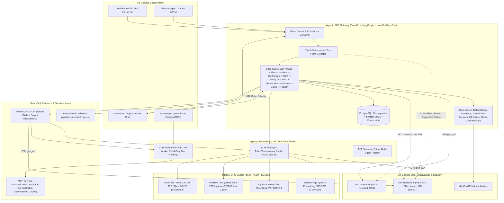

# Agentic SRE & Platform Engineering System - Research, Architecture Review, and Air-Gap Modernization Plan

> **Date:** 2026-11-26
> **Status:** Approved -- Locked Decisions Recorded (ready for P0 implementation on local RTX 3000 laptop)
> **Scope:** Full monorepo review (`agentic-sre-framework/`, `agentic-sre-team/`, `open-sre-agents/`)
> **Core Constraint:** Must run fully **offline / air-gapped** on **self-hosted open-weight (OSS) models on internal GPU infrastructure**, with **no frontier cloud LLM access** and **no degradation that renders automated SRE workflows unusable**.

---

## Executive Summary

Between July 2026 (last commit `a3211a4`) and November 2026, two things changed:

1. **The project's operating constraint hardened:** Air-gapped, offline execution on self-hosted OSS models is no longer a secondary "degraded fallback" profile -- it is the **primary design target**. Automated SRE and Platform Engineering workflows must stay reliable, fast, and useful without frontier cloud APIs (Vertex AI, Bedrock, Anthropic, OpenAI), SaaS observability (Grafana Cloud, LangSmith), or internet-only chat (Telegram).
2. **The OSS and CNCF cloud-native agentic ecosystem matured substantially:** Production-grade open-source standards now exist for every layer that previously required cloud services or custom glue -- notably **kagent v1 + Agent Substrate** (CNCF Sandbox), **agentgateway v1.x** (Linux Foundation / kgateway AI data plane for LLM + MCP + A2A), **llm-d v1.0** (CNCF Sandbox distributed vLLM inference over Gateway API Inference Extension), **HolmesGPT 0.43.x** (Skills, Operator mode, HTTP Connectors, OTel), **OpenChoreo / Backstage MCP Catalog**, **OpenTelemetry GenAI semantic conventions (`gen_ai.*`)**, **self-hosted Langfuse** (MIT air-gapped), and a new generation of Apache-2.0/MIT open-weight models (**Qwen3.6/3.8-27B**, **Qwen3.6-35B-A3B**, **gpt-oss-120B**, **DeepSeek-V4**, **GLM-5.2**, **Qwen3-Embedding**, **BGE-M3**) with zero-overhead **XGrammar / LLGuidance constrained decoding**.

**Bottom line of our repo review:** `agentic-sre-team/` has a **strong architectural core** (deterministic LangGraph `StateGraph` with Postgres checkpointing, hypothesis board, evidence receipts, dedicated citation verification, two-gate HITL, default-deny manifests, append-only audit, and 119+ solid tests). However, if deployed offline onto OSS models as currently written, **it will degrade severely or fail completely** due to:
- Unwired air-gap config (`models_profile="airgap"` is ignored in code; USD-only pricing/budgets; online Docker builds; Telegram-only live channel; cloud-only LangSmith).
- **OSS-model harness fragility** (prompt-only JSON parsing that breaks on `<think>` blocks, no vLLM constrained decoding, unconstrained HolmesGPT ReAct tool loops that already caused Gemini 2.5 Flash to loop, aggressive 200-300 char evidence truncation that hides stack traces, pure-vector RAG without BM25, and zero deterministic pre-flight evidence gathering or graceful offline fallback).
- **Security & reliability gaps** (Grafana MCP write tools protected only by Viewer token role rather than gateway tool filtering, dead-code per-agent daily budget enforcement, gate resume crash window, and unauthenticated Holmes sidecar).

The good news: late-2026 benchmarks prove that **harness engineering (deterministic pre-collection + runbook/skill injection + grammar-constrained decoding + deterministic validation gates) matters far more than frontier model size**. By modernizing the harness and swapping cloud dependencies for CNCF/OSS air-gap primitives, this platform can match or exceed the reliability of cloud-backed setups using strictly internal GPUs.

---

## Part 1: Late-2026 Research -- Trends, Technologies, and Reference Designs

### 1.1 The Cloud-Native Agentic Control Plane (CNCF & Linux Foundation)

In 2025-2026, the cloud-native ecosystem converged on a layered, open-source architecture for running agents on Kubernetes/OpenShift:

| Layer | Leading 2026 OSS / CNCF Project | License / Status | Role & Relevance to This Platform |
|---|---|---|---|
| **Agent Runtime & Sandboxing** | **kagent v1** + **Agent Substrate** + **kmcp** (`kagent.dev`) | Apache 2.0 / CNCF Sandbox | Declarative K8s CRDs for deploying, sandboxing, suspending-when-idle, and governing agents + MCP servers. Integrates with Istio Ambient Mesh & SPIFFE/SPIRE workload identities. |
| **Unified AI / Tool / Agent Gateway** | **agentgateway v1.x** (`agentgateway.dev`, Linux Foundation / `kgateway` data plane) | Apache 2.0 / Linux Foundation | High-performance **Rust** data plane speaking **LLM APIs, MCP, A2A, and HTTP/gRPC**. Provides CEL-based per-caller MCP tool filtering (`tools/list` filtering + runtime deny), token budgets, prompt guards, warm-replica routing, and OpenAPI-to-MCP. Directly solves the LiteLLM Python supply-chain/rolling-tag risk noted in `2026-06-08-llmops-platform-design.md` (§9.1.7) AND our MCP write-surface problem. |
| **Distributed Self-Hosted Inference** | **llm-d v1.0** (`llm-d.ai`) + **vLLM v0.33** / **SGLang v0.5** | Apache 2.0 / CNCF Sandbox (Mar 2026) | Kubernetes-native distributed inference built on **vLLM** and **Gateway API Inference Extension (GAIE)**. Adds **KV-cache prefix-aware routing**, prefill/decode disaggregation, hierarchical KV offloading, and hardware-aware autoscaling. Prefix-cache routing is a massive win for SRE agents where multi-round prompts share system instructions, environment topology, and accumulated evidence. |
| **SRE Investigation Engine** | **HolmesGPT 0.43.x** (`holmesgpt.dev`) | MIT / CNCF Sandbox (Oct 2025) | Evolved substantially past this repo's pinned `0.36.0`: added **Skills** (replacing static runbooks), **Holmes Operator** (deployment verification & continuous health checks), **HTTP Connectors** with host/path/method allowlists, **Tool Output Transformers**, native **OpenTelemetry** tracing, and 150+ scenario benchmarks. *Governance note:* Robusta's parent acquisition by an ITSM vendor raised community questions about long-term neutrality -- preserving this repo's thin adapter seam (`HolmesClient`) or supporting direct MCP workers remains strategically essential. |
| **Agent-Ready IDP / Service Catalog** | **OpenChoreo v1.3** (CNCF Sandbox, Jan 2026) & **Backstage 2026** (`AiResource` + Catalog MCP) | Apache 2.0 / CNCF | Modern platform engineering treats the Internal Developer Platform (IDP) catalog as an **MCP context hub** exposing service ownership, topology, dependencies, SLOs, and on-call metadata to agents dynamically -- replacing static hand-maintained YAML files (`environment.yaml`). |
| **Agent Protocols** | **MCP** (Model Context Protocol) + **A2A** (Agent2Agent v1) | Linux Foundation (both) | **MCP** standardizes agent-to-tool/context connectivity (Streamable HTTP, OAuth/JWT); **A2A** reached v1 stable in 2026 and standardizes cross-agent delegation (Agent Cards + JSON-RPC tasks). Enables expanding from one monolithic incident graph to the full multi-agent SRE/Platform roster without tight coupling. |
| **Agent & LLM Observability** | **OpenTelemetry GenAI SemConv (`gen_ai.*`)** + **Langfuse** (MIT core, ClickHouse) or **OpenLIT** (Apache 2.0) | MIT / Apache 2.0 | OTel `gen_ai.*` conventions (spans for model calls, tool calls, agent invocations, sessions) became the interoperable tracing layer in 2026. **Langfuse** (acquired by ClickHouse in Jan 2026; MIT core unchanged) runs the exact same codebase air-gapped with zero internet beacons, native OTel `/api/public/otel` ingestion, prompt versioning, and CI/CD dataset eval gates. |

### 1.2 Open-Source AI SRE & AIOps Competitive Landscape (2026)

| Tool | Model / Positioning | Key Strengths | Key Limitations / Lessons for Us |
|---|---|---|---|
| **HolmesGPT** (CNCF Sandbox) | Multi-step alert/incident investigator (0.43.x) | 31/38 correct on Arvo's 19-fault K8s benchmark, ~3x faster than Aurora; rich Prometheus/Loki/Tempo/K8s/MCP/Skills ecosystem. | Open-ended tool loop can loop on smaller/faster models (already observed in this repo with Gemini Flash); no built-in multi-gate HITL governance or hypothesis board. |
| **Aurora** (Arvo AI, Apache 2.0) | Multi-cloud + K8s agentic RCA | 34/38 correct on its public 19-fault benchmark (`Arvo-AI/aurora-lab`), strong self-hosted/BYO-LLM focus. | Slower investigation turnaround; younger ecosystem than HolmesGPT. Public `aurora-lab` fault suite is an excellent reference for our own offline evaluation harness. |
| **K8sGPT** (CNCF) | Cluster diagnostic scanner + local Ollama/vLLM | Fast deterministic K8s analyzers run *before* the LLM explains them -- great model for deterministic-first diagnostics. | Diagnostic scanner rather than multi-step cross-telemetry incident investigator. |
| **OpenSRE** (Tracer-Cloud) | Open-source CI/CD reliability agent | Focused on self-hosted CI/CD failure investigation. | Narrower scope (CI/CD only); confirms strong demand for this repo's `pipeline_failure` case kind. |
| **Keep** (`keephq/keep`, MIT core) | Alert deduplication, correlation & YAML workflows | Declarative alert workflows & topology correlation. | Acquired by Elastic (May 2025), community-maintained cadence; AI correlation is not in OSS core. Confirms building lightweight deterministic grouping inside our own gateway was the right call. |
| **Coroot** (Apache 2.0) | eBPF + deterministic root-cause heuristics | Zero-LLM deterministic service dependency maps, latency/error localization, and K8s bottleneck detection. | Great example of how deterministic telemetry engines should feed structured facts into agents rather than asking LLMs to discover topology from scratch. |

### 1.3 Crucial Empirical Finding for Air-Gapped / OSS-Model Operation

Late-2026 SRE agent evaluations (including public benchmarks on Kubernetes fault suites and payment-timeout failure analyses) converged on three decisive findings:

1. **Unconstrained ReAct exploration fails even with frontier models:** In controlled microservice timeout benchmarks (Nov 2026), a frontier-backed HolmesGPT loop given raw cluster state and telemetry blamed the wrong service **4 out of 5 times**.
2. **Runbook / Skill injection + deterministic pre-flight evidence flips accuracy and speed:** Injecting structured domain runbooks/skills and deterministic triage checklists cut diagnosis time by **~60% (55s to 22s)** and eliminated misattribution -- while dramatically lowering the reasoning burden on the LLM.
3. **Three deterministic validation layers protect production regardless of model size:**
   - *Evidence validation* (every claim anchored to real tool output & deterministic existence checks),
   - *Action criteria validation* (pre-checks, syntax/dry-run linters for YAML/PromQL/Ansible/K8s manifests),
   - *Blast-radius / policy gates* (default-deny MCP tool filtering + human-in-the-loop approval).

**Strategic implication for our constraint:** We do **not** need frontier cloud models to avoid degradation. We need to shift complexity out of unconstrained LLM loops and into **deterministic pre-collection, structured runbook/skill guidance, grammar-constrained decoding, hybrid search, and automated verifiers**.

### 1.4 Late-2026 Open-Weight Models & Inference Stack for Air-Gap GPU Infra

The June/July 2026 model assumptions in `agentic-sre-framework/docs/framework/06-deployment-model.md` (Qwen-7B / Llama-3-8B / Qwen-32B / DeepSeek-V3 / MiniMax-M2) are now outdated. As of November 2026, permissive-license (Apache 2.0 / MIT) open-weight models have closed much of the agentic tool-calling and coding gap:

| Tier | Recommended Late-2026 OSS Models (Permissive License) | Hardware Footprint (Quantized FP8/AWQ) | Role in This Platform |
|---|---|---|---|
| **Small / Fast** | **Qwen3.6-35B-A3B** (MoE, 3B active, Apache 2.0) or **Qwen3.5-9B** (Apache 2.0) or **Mistral Small 4** | 1x 24-48 GB GPU (L40S / A10G / RTX 4090-class) | Triage, chat likelihood scoring, citation entailment verification, learning distillation. Ultra-low latency + native tool calling. |
| **Medium / Workhorse** | **Qwen3.6-27B Dense** / **Qwen3.8-27B** (Apache 2.0) or **gpt-oss-120B** (MoE, 5.1B active, Apache 2.0) | 1x 48-80 GB GPU (L40S / A100 80GB / H100) | Evidence workers, synthesis, standard RCA & runbook drafting. Qwen3.6/3.8-27B uses hybrid Gated DeltaNet + full attention (tiny KV cache on long logs), scores 77.2% SWE-bench Verified / 59.3% Terminal-Bench 2.0, and supports adaptive Thinking/Non-Thinking modes. |
| **Heavy / Complex Reasoning** *(optional if multi-GPU available)* | **DeepSeek-V4** (MIT) or **GLM-5.2** (MIT) | Multi-GPU (4-8x 80GB H100/H200/A100, FP8) | Complex cross-service RCA escalation, subtle code-level remediation patches, adversarial eval judging. *Note: Platform must remain fully effective even if only Small + Medium tiers are provisioned.* |
| **Embeddings (Air-Gap)** | **Qwen3-Embedding-0.6B / 4B / 8B** (Apache 2.0, supports Matryoshka 768-dim) or **BGE-M3** (MIT, 568M, dense + sparse) | CPU or <4-16 GB VRAM (vLLM pooling or HuggingFace TEI) | Runbook & case-learning indexing + retrieval, paired with PostgreSQL `tsvector` BM25 hybrid search. |

**Critical Serving Capability:** Both **vLLM (v0.33)** and **SGLang (v0.5.x)** ship native **XGrammar / LLGuidance** grammar-constrained decoding (`response_format={"type": "json_schema", ...}` and strict `tool_choice` parsers) plus automatic **prefix caching**. Using constrained decoding turns structured JSON output reliability on 9B-35B OSS models from fragile (~70-85%) to **100% schema-valid**.

---

## Part 2: Repository Design & Codebase Review

### 2.1 Monorepo Inventory & Current State

The repository currently contains three distinct sub-projects plus an empty root `README.md`:

1. **`agentic-sre-framework/`** (Docs only -- May-June 2026):
   - `docs/framework/01..08`: Executive + engineering blueprint for a 9-agent SRE/SysAdmin roster on OpenShift (on-prem) and AWS (online).
   - `docs/llm-ops-spec/2026-06-08-llmops-platform-design.md`: Sibling multi-tenant AI/LLMOps platform spec (Visual Builder, Runtime, Langfuse, Policy Engine/Cedar, LiteLLM, WORM audit).
2. **`agentic-sre-team/`** (Active Runnable Implementation -- July 2026, Phases 0-6 of 9 merged to `main`):
   - **Gateway** (`gateway/src/sre_gateway/`): Python 3.12, FastAPI, LangGraph 1.x library mode, `AsyncPostgresSaver`, SQLAlchemy 2 async + Alembic + pgvector, HolmesGPT 0.36.0 HTTP client, Grafana webhook + poller, noise control + correlation grouping, Telegram Bot API long-poller, 119 pytest tests green.
   - **UI** (`ui/`): React 19 + Vite 7 + TypeScript + TanStack Query + nginx; Case Queue + Activity Timeline, 3-pane Case Detail + Live Ledger + Hypothesis Board + Evidence Receipts, Artifact Review + Citation Inspector + Approval Bar, Governance Screen; 10 Vitest tests + Playwright E2E green.
   - **Remaining unbuilt phases in original plan:** Phase 7 (SCM/CI pipeline-failure cases), Phase 8 (Console Chat surface), Phase 9 (Chaos + Grafana provisioning + Acceptance demo).
3. **`open-sre-agents/`** (Legacy AWS MVP -- May 2026):
   - AWS ECS/RDS/FIS/Lambda/Next.js prototype using OpenSRE + Claude. Explicitly superseded by `agentic-sre-team/` per `2026-07-11-agentic-sre-team-design.md`.

### 2.2 Architectural Strengths to Preserve

Do **not** throw away the core design of `agentic-sre-team/`. It is genuinely ahead of most OSS SRE projects in several critical areas:

- **Deterministic StateGraph orchestration (`graph/build.py`, `graph/routers.py`):** Routing, round limits (`MAX_ROUNDS = 2`), effort fan-out (`Send`), and repair bounds live in deterministic Python edges, not LLM whims.
- **Hypothesis-driven investigation + Evidence Receipts (`db/models.py`, `workers.py`, `synthesize.py`):** Explicit tracking of supported, refuted, and open hypotheses with atomically allocated `E1..En` evidence IDs prevents silent tunnel vision.
- **Dedicated Citation Verification loop (`graph/nodes/verify.py`):** Combines a deterministic check (all cited `EID`s exist, non-empty claims) with an LLM entailment check and one bounded repair pass.
- **Two-gate HITL with active-time budgeting (`graph/nodes/gates.py`, `budget.py`):** `interrupt()` / `Command(resume=...)` with approve, approve-with-edits (unified diff stored), and reject; `waited_seconds` correctly excludes human review latency from active wall-clock budgets.
- **Default-deny permission manifests & read-only core (`manifests.py`, `config/agents/*.yaml`):** Zero write tools exist in `TOOL_REGISTRY`; `scm_draft_mr` is strictly a human-approved gateway publish action.
- **Generic SUT abstraction (`config/environment.yaml`):** Decouples prompts from the reference SUT (Spectre).
- **Strong offline testability (`testing/fake_holmes.py`, `llm/scripted.py`):** Full graph + UI E2E tests already run without external network calls.

### 2.3 Critical Gaps & Defects Identified in Review

#### A. Air-Gap Blockers (System Cannot Run Offline Today)

| # | Finding & Exact Location | Impact in Air-Gap |
|---|---|---|
| **A1** | **Broken `airgap` profile wiring** (`settings.py:45-47`): `models_config_path` only checks `models_profile == "fake"`, falling back to Vertex `models.yaml` for `"airgap"`. No `config/models.airgap.yaml` exists. | Cannot switch to self-hosted OSS models via config without code edits. |
| **A2** | **USD-only pricing & budget model** (`llm/factory.py:51-54`, `budget.py:46-59`, `config/agents/*.yaml`): Startup raises `ValueError` if a non-fake model lacks a USD/1M-token entry; per-agent budgets are solely `usd_per_day`. | Misaligned with self-hosted GPU infra (fixed capex, constrained by **tokens/min, GPU-seconds, KV-cache concurrency, and queue depth**, not per-token USD). |
| **A3** | **No air-gapped Chat/Notification/Approval channel** (`channels/`): Only `TelegramChannel` and `LogChannel` exist. Telegram Bot API (`api.telegram.org`) is unreachable offline. | Zero chat notifications, chat intake, or chat-based HITL approvals in an air-gap (only Web UI works, and Web UI lacks auth/SSO). |
| **A4** | **Cloud-only LLM observability & split traces** (`.env.example:13-16`, `2026-07-11-agentic-sre-team-design.md:124-130`): Relies on proprietary **LangSmith Cloud** (off in air-gap), and HolmesGPT's internal tool loop is never traced. | Blind to OSS model latency, tool-call failures, token waste, and quality drift offline. |
| **A5** | **Online-only Docker builds & local-Docker-only deployment** (`gateway/Dockerfile`, `ui/Dockerfile`, `docker-compose.yml`): `uv sync` and `npm ci` pull from public PyPI/npm; base images pull from `ghcr.io`/Docker Hub; `docker-compose.yml` hardcodes Vertex ADC mounts and Grafana Cloud vars. No Helm chart / Kustomize / OpenShift SCC manifests or offline air-gap bundle script (OCI image archive + model weight manifest + wheel/npm cache). | Cannot build or deploy into a disconnected Kubernetes/OpenShift cluster. |
| **A6** | **Embedding server incompatibility** (`llm/factory.py:102-107`, `db/models.py:11`): Hardcodes `Vector(768)` and always passes `dimensions=768` to `OpenAIEmbeddings`. | Many self-hosted OpenAI-compatible embedding endpoints (vLLM, TEI, Ollama) reject or ignore `dimensions` unless backed by a Matryoshka-capable model (e.g., `Qwen3-Embedding`), causing runtime 400/dimension-mismatch crashes. |

#### B. OSS-Model Degradation Risks (Will Make Automation Unusable Without Frontier LLMs)

| # | Finding & Exact Location | Why It Breaks on OSS Models |
|---|---|---|
| **B1** | **Prompt-only JSON + naive brace slicing** (`llm/json_call.py:20-29, 39-76`): Prompts the schema as text and slices `text.find("{")` to `text.rfind("}")`. | **Catastrophic on OSS reasoning models** (`Qwen3` Thinking, `DeepSeek`, `GLM`) that emit `<think>...</think>` blocks. Any `{` inside reasoning (e.g., PromQL `rate(http_requests{code="500"}[5m])` or K8s JSON) poisons `find("{")` and fails `json.loads`. Ignores vLLM/SGLang **XGrammar/LLGuidance constrained decoding** (`response_format: json_schema`). Also leaves `TODO(Task 25)` unfixed (retries 4xx/context-length errors needlessly). |
| **B2** | **Unconstrained HolmesGPT ReAct loop + soft prompt-only tool scoping** (`config/holmes.yaml:4`, `graph/nodes/workers.py:11-33, 95-98`): `holmes.yaml` already notes *"`gemini-2.5-flash` loops"*. Workers hand Holmes all enabled toolsets and hope the prompt keeps each worker in its lane. | Smaller/medium OSS models loop, pick wrong toolsets, or exhaust context when exposed to 30-60+ unfiltered tools (Prometheus + Loki + Tempo + ES + Grafana MCP + GitHub/GitLab MCP). |
| **B3** | **Zero deterministic pre-flight evidence collection & no non-LLM fallback** (`graph/build.py`, `graph/nodes/plan.py`, `graph/nodes/workers.py`): Every case starts cold with LLM calls; if GPU inference is down/saturated or an LLM fails, `runner.py:173-190` just parks the case. | Violates the core constraint (*"without degradation, where the automated solutions becomes unusable"*). Basic golden signals (service health, pod/container state, K8s events, recent error-log tail, recent deploys/commits, matched runbooks, Grafana deep links) should be gathered **deterministically in <5s before any LLM runs**, producing a high-value **Deterministic Diagnostic Packet** even if all LLMs are offline! |
| **B4** | **Severe evidence truncation starves downstream reasoning** (`workers.py:131` = 2000 chars; `synthesize.py:56`, `rca.py:80`, `verify.py:55` = **300 chars**; `remediate.py:72` = **200 chars**): Always takes the *head* (`[:300]`). | Stack traces, K8s `describe` events, and CI job failures place root causes at the **tail** or past byte 300. Truncating to head-300 forces OSS models to guess (hallucinate) and causes `verify.py` to falsely reject valid claims whose supporting line appeared at byte 450! |
| **B5** | **Pure dense vector retrieval with no BM25 hybrid search or relevance cutoff** (`retrieval.py:20-52`): Always returns top-3 cosine neighbors regardless of score; no keyword/exact-match search; `workers.py` doesn't receive matched runbooks/skills (only `triage.py` gets a 400-char snippet). | SRE incidents depend heavily on exact tokens (`OOMKilled`, `CrashLoopBackOff`, `502 Bad Gateway`, error codes, metric names). Without hybrid `tsvector` + `pgvector` (RRF) and similarity thresholds, irrelevant runbooks pollute OSS model context and matched runbooks never guide worker queries. |
| **B6** | **No automated remediation/query validation before HITL** (`graph/nodes/remediate.py`, `config/agents/remediate.yaml`): `remediate` drafts shell/YAML/PromQL/code patches purely via LLM text generation with zero syntax/dry-run verification. | OSS models produce higher draft error rates unless paired with deterministic validators (`yamllint`, `kubectl --dry-run=client`, `promtool check rules`, `ansible-lint`, `ruff`/`tsc`, `git apply --check`). |
| **B7** | **No offline benchmark / regression evaluation suite**: Tests only run against static JSON fixtures (`ScriptedChatModel` + `fake_holmes`). | Impossible to measure or prove zero-degradation when upgrading OSS model weights, quantizations, prompts, or HolmesGPT versions. |

#### C. Security, Governance & Reliability Defects

| # | Finding & Exact Location | Risk & Remediation |
|---|---|---|
| **C1** | **Grafana MCP write tools exposed at protocol level** (`config/holmes.yaml:44-56`): Read-only-ness relies solely on `GRAFANA_SA_TOKEN` remaining Viewer-role. | One misconfigured token turns the evidence layer write-capable. Front all MCP servers with **agentgateway** enforcing CEL per-caller tool allowlists (`tools/list` filtering + runtime deny). |
| **C2** | **Per-agent daily budgets are dead code** (`budget.py:55-59`, `graph/deps.py:41-61`): `check_agent()` is defined and unit-tested, but `guarded()` only calls `check_case()` -- never `check_agent()`. | Daily spend/token caps in `config/agents/*.yaml` are displayed in the UI (`api/governance.py:29`) but never actually enforced! |
| **C3** | **Gate resume crash window** (`graph/nodes/gates.py:62-67`) & **untracked wait time on error-park** (`graph/runner.py:179-185`): Crash between `interrupt()` resume and DB commit strands the case in `waiting_approval`; error-parked cases never stamp `waiting_since`. | Fix with transactional idempotency key on `Approval`, startup DB-vs-checkpoint reconciliation, and stamping `waiting_since` on error-park. |
| **C4** | **Unauthenticated Ops Console API & Holmes sidecar** (`api/app.py`, `docker-compose.yml:56-79`): No OIDC/Keycloak JWT verification on `/api/cases/*/decision` or `/api/governance/pause`; `decided_by` is client-supplied; `HolmesClient` leaks httpx pool (missing `aclose()`). | Air-gap production requires Keycloak/OIDC SSO for HITL approver identity & RBAC, mTLS/network policy isolating Holmes/MCP, and `HolmesClient.aclose()` in FastAPI lifespan. |
| **C5** | **Audit log lacks hash-chaining & WORM export** (`audit.py`, `alembic/versions/0003_audit_append_only.py`): Append-only Postgres trigger exists, but no SHA-256 hash chain (`prev_hash` -> `row_hash`) or MinIO WORM sink as specified in `04-orchestration-and-governance.md`. | Add hash chaining + offline verifier + optional MinIO WORM archival. |
| **C6** | **Single-process in-memory `CaseRunner`** (`graph/runner.py`): Active tasks, per-case locks, sequence counters, and SSE subscriber queues live in process memory. | Blocks horizontal HA (`replicas: 2`) on Kubernetes/OpenShift; move event fan-out/locking to Postgres `LISTEN/NOTIFY` + advisory locks (or NATS/Kafka when scaling). |

#### D. Platform Engineering & Monorepo Hygiene Gaps

| # | Finding | Impact |
|---|---|---|
| **D1** | **Static `environment.yaml` vs dynamic Platform Catalog:** Only describes a small Docker Compose stack; no Kubernetes/OpenShift discovery or Backstage/OpenChoreo catalog MCP sync, no on-call/maintenance-window integration. | Limits Platform Engineering value beyond static single-stack demos. |
| **D2** | **Only Incident slice built (Phases 0-6):** Pipeline failures (Phase 7), Console Chat (Phase 8), and the broader Platform Engineering roster (`SysAdmin Drafter`, `Postmortem Scribe`, `Observability Engineer`, `Security Triage`, `Compliance Evidence`) are unbuilt. | Repo currently covers only reactive L1/L2 incident triage/RCA. |
| **D3** | **Fragmented monorepo & broken cross-machine AI context:** Empty root `README.md`; no root `AGENTS.md`/`CLAUDE.md`; `HANDOFF.md` references local laptop paths (`~/Code/agentic-ons/.superpowers/sdd/progress.md`, `~/.claude/projects/...`) not in git; framework docs still assume AWS/Vertex/LiteLLM/older models and accept on-prem degradation. | Any new agentic session on another laptop or IDE provider starts blind or follows obsolete cloud-first instructions. |

---

## Part 3: Target Air-Gap-First Architecture & Improvement Plan

### 3.1 The "Zero-Degradation Offline" Design Doctrine

To guarantee that the platform runs fully air-gapped on self-hosted OSS models **without degrading into an unusable tool**, we establish six architectural laws:

1. **Deterministic-First Pre-Flight (Tier 0 -- Zero LLM Required):**
   On every opened case, a fast deterministic `preflight` node runs *before* `triage` and *before* LLM workers. Using direct read-only adapters (K8s/OpenShift API or Docker, Prometheus instant/range golden-signal queries, Loki/OpenSearch error-tail queries, recent GitLab/GitHub commits/deploys, hybrid Runbook + Learning lookup), it assembles a **Deterministic Diagnostic Packet** in <5 seconds.
   - *When GPUs are healthy:* The packet pre-grounds `triage` and workers, cutting required LLM tool calls by 50-70% and dramatically boosting OSS model accuracy.
   - *When GPUs are saturated, slow, or offline:* The system automatically switches to **Degraded-Inference / Deterministic Mode** -- operators still receive alert correlation, golden-signal snapshots, recent deploy diffs, matched runbooks, and deep links in the Ops Console + Mattermost within seconds!
2. **Grammar-Constrained Structured Outputs Everywhere:**
   Replace prompt-only JSON parsing in `call_llm_json` with OpenAI-compatible `response_format={"type": "json_schema", ...}` backed by vLLM/SGLang **XGrammar/LLGuidance**, plus explicit `<think>...</think>` stripping (storing reasoning traces separately for audit/debug) and strict provider error classification (never retry 4xx/auth/context-overflow).
3. **Runbook / Skill-Guided, Tool-Filtered Workers:**
   Upgrade HolmesGPT (`0.36.0` -> `0.43.x+`) to leverage **Skills** and **Tool Output Transformers**, pass matched runbooks/skills directly into worker prompts, and place **agentgateway** in front of all MCP servers so each worker domain (`metrics`, `logs`, `infra`, `changes`, `ci`) sees **only its 4-8 domain-scoped, strictly read-only tools** via CEL-filtered `tools/list`. Smaller OSS models thrive with 5 crisp tools and fail with 50 unfiltered ones.
4. **Smart Evidence Summarization (Head+Tail & Salient Excerpts, Never Blind `[:300]`):**
   Replace blind `[:300]` head truncation with structured evidence extractors (head + tail windowing, error/exception line extraction, PromQL numeric summary, diff hunks) so OSS models and `verify_citations` always see the causal signal without blowing context budgets.
5. **Hybrid Retrieval (`pgvector` + PostgreSQL `tsvector` BM25 + RRF) with Thresholds:**
   Combine local OSS embeddings (`Qwen3-Embedding` at 768-dim MRL or `BGE-M3`) with Postgres full-text BM25 via Reciprocal Rank Fusion (RRF) and minimum relevance cutoffs. If the embedding service is unavailable, BM25 seamlessly continues working with zero crashes.
6. **Deterministic Verification Before Human Review:**
   Add a deterministic validation layer after `remediate` (`promtool`, `yamllint`, `kubectl --dry-run=client`, `ansible-lint`, `git apply --check` in an isolated sandbox container) so OSS-drafted runbooks, alerts, and patches arrive pre-validated at HITL gates.

### 3.2 Target Air-Gapped Cloud-Native Architecture

### 3.3 Current (July 2026) vs Target (Air-Gap-First 2026+) Technology Matrix

| Capability | Current Repo (`agentic-sre-team`, Jul 2026) | Target Air-Gap-First Platform (Nov 2026+) |
|---|---|---|
| **LLM Inference** | Vertex AI (`gemini-2.5-flash` / `gemini-2.5-pro`) | **Local dev:** Ollama / llama.cpp / vLLM on RTX 3000 (54GB total GPU memory; quantized `Qwen3.5-9B`, `Qwen3.6-35B-A3B`, `Qwen3.6-27B`). **Air-gap cluster:** **llm-d + vLLM (v0.33) / SGLang** across multi-GPU cluster (`Qwen3.6-35B-A3B`, `Qwen3.6/3.8-27B`, `DeepSeek-V4` / `GLM-5.2`) |
| **LLM / MCP Gateway** | Direct SDK calls + raw Grafana MCP URL | **Interchangeable OpenAI-compatible LLM gateway** (`SRE_LLM_GATEWAY_URL`: supports existing production **LiteLLM** AND **agentgateway v1.x** via config swap) + **agentgateway** (Rust, LF/CNCF) for MCP federation, CEL per-caller read-only tool filtering, and A2A |
| **Structured Outputs** | Prompt-only JSON + `find("{")`..`rfind("}")` | Native **XGrammar / LLGuidance** `json_schema` constrained decoding + `<think>` tag extraction + error classification |
| **Embeddings & RAG** | Vertex `gemini-embedding-001` (768), dense-only cosine | **Qwen3-Embedding** (0.6B local / 4B-8B cluster, Apache 2.0, MRL 768) or **BGE-M3** + **Postgres Hybrid Search** (`pgvector` + `tsvector` BM25 + RRF + score thresholds) |
| **Evidence Engine** | HolmesGPT `0.36.0` (prompt-scoped, no skills, no pre-flight) | **Tier-0 Deterministic Pre-Flight Collector** + **HolmesGPT `0.43.x+`** (Skills, Output Transformers, OTel) behind `HolmesClient` + per-domain scoped MCP via `agentgateway` |
| **LLM Observability** | Cloud LangSmith (off in air-gap); Holmes untraced | **OpenTelemetry GenAI (`gen_ai.*`)** everywhere: local **Grafana Tempo** by default on laptop, **self-hosted Langfuse** (MIT + ClickHouse) via optional local Compose profile and always-on in cluster Helm charts |
| **Chat / HITL Channel** | Telegram Bot API (internet-only) | **Ops Console UI (toggleable Keycloak OIDC SSO)** + **Mattermost** (primary air-gap chat + approvals) + GitLab Issue comments; Telegram kept opt-in for online dev |
| **Budgets & Quotas** | USD/day (`check_agent` dead code) | **Token/day + GPU-seconds + active-concurrency slots + priority queue** (enforced at both `guarded()` and LLM gateway) |
| **Target Environment** | Local Docker Compose + Grafana Cloud + Spectre | **First:** Local Docker Compose "air-gap-in-a-box" (self-hosted LGTM + Ollama/vLLM + gateway + Spectre/demo SUT, zero cloud). **Second:** **Kubernetes / OpenShift (Helm + ArgoCD GitOps)** on multi-GPU air-gap cluster + dynamic **Backstage / OpenChoreo MCP Catalog** |
| **Offline Supply Chain** | Online `uv sync` / `npm ci` / public registries | **Air-gap bundle pipeline**: mirrored OCI images (digest-pinned + Cosign), offline Python wheelhouse & npm tarball cache, signed model-weight manifest |
| **Quality Assurance** | Fake scripted unit/E2E tests only | Fake tests **PLUS** **Offline Replay & Fault-Injection Benchmark Suite** (adapted from `aurora-lab` / Spectre chaos scenarios) gating OSS model/prompt changes in Langfuse |

---

## Part 4: Prioritized Improvements & Change Roadmap

### Priority 0 -- Air-Gap & Zero-Degradation OSS-Model Foundation (Do First)

These changes directly satisfy the air-gap/OSS-only constraint and eliminate every known failure mode on both local laptop GPUs and multi-GPU clusters:

1. **P0.1 -- Wire First-Class Local-GPU & Air-Gap Cluster Profiles (Interchangeable Gateway):**
   - Fix `settings.py:models_config_path` to resolve `models.{profile}.yaml` (`fake`, `local`, `local-gpu`, `airgap`).
   - Ship `config/models.local-gpu.yaml` (RTX 3000 54GB laptop dev: Ollama/vLLM quantized `Qwen3.5-9B` / `Qwen3.6-35B-A3B` / `Qwen3.6-27B` + lightweight local embeddings) AND `config/models.airgap.yaml` (multi-GPU cluster: Small + Medium + Heavy tiers behind `SRE_LLM_GATEWAY_URL`, seamlessly supporting either **LiteLLM** or **agentgateway** with zero code changes).
   - Remove mandatory USD pricing requirement in `llm/factory.py`; make pricing optional and introduce **token/day + GPU-second + concurrency** budgets alongside optional USD.
   - Make `OpenAIEmbeddings` `dimensions` parameter optional/config-driven (`send_dimensions: bool`) so non-Matryoshka OSS embedding servers work cleanly.
2. **P0.2 -- Harden `call_llm_json` for OSS & Reasoning Models:**
   - Support provider-native **grammar-constrained JSON Schema decoding** (`response_format={"type": "json_schema", ...}` via `extra_body` / `with_structured_output` for vLLM/SGLang/Ollama) with automatic fallback to prompt-JSON only for `fake` or legacy providers.
   - Strip and capture `<think>...</think>` reasoning blocks before JSON extraction so PromQL/JSON braces inside thinking traces never break parsing; log thinking length/tokens to audit.
   - Implement proper exception classification (`TODO(Task 25)`): fail fast on 400/401/403/404/context-length errors; retry only 429/5xx/timeouts with jitter; add adaptive context-trimming retry on context-overflow.
3. **P0.3 -- Build Tier-0 Deterministic Pre-Flight Collector & Graceful Offline Fallback:**
   - Insert a deterministic `preflight` node between `START` and `triage` (zero LLM calls).
   - Deterministically collect golden signals for implicated services (Prometheus error rate/latency/saturation, Loki/OpenSearch last-N error lines, K8s/Docker pod/container state & events, recent commits/deploys, hybrid Runbook + Learning hits, Grafana Explore deep links) into `EvidenceRow`s (`E1..Ek`).
   - Add an **Inference Circuit Breaker / Degraded Mode**: if the LLM gateway is unreachable, timed out, or queue-saturated, publish the **Deterministic Diagnostic Packet** immediately to the Ops Console and chat channel so on-call engineers still get instant, actionable triage without waiting on GPUs.
4. **P0.4 -- Fix Evidence Truncation, Hybrid Retrieval, and Runbook/Skill Injection:**
   - Upgrade `retrieval.py` + Alembic migration to add Postgres `tsvector` + GIN index and perform **Hybrid Search (BM25 + pgvector cosine via RRF)** with configurable minimum relevance thresholds and automatic BM25-only fallback if the embedding service is down.
   - Replace naive `[:300]` head truncation in `synthesize.py`, `rca.py`, `verify.py`, and `remediate.py` with structured head+tail / salient-line extractors and per-node token budgets.
   - Inject matched runbooks and prior case learnings directly into **evidence worker prompts** (not just `triage`), and map them to HolmesGPT `Skills`.
5. **P0.5 -- Fix Existing Governance, Security, and Reliability Bugs:**
   - Wire `budget.check_agent()` into `graph/deps.py:guarded()` (converting per-agent daily caps to token-based caps in air-gap).
   - Fix `gates.py` crash-window with idempotent approval insertion (`unique(case_id, artifact_id, gate)` or transition token) and startup DB-vs-checkpoint reconciliation.
   - Stamp `waiting_since` in `runner.py` when error-parking a case; add `HolmesClient.aclose()` in `api/app.py` lifespan.
   - Fix UI SSE `lastEventId` token-frame reset and `Ledger.fold` multi-round key overwrite (deferred Phase 5 watch-items).

### Priority 1 -- Complete Core Air-Gap Stack (Local Air-Gap-in-a-Box -> Cluster Helm)

6. **P1.1 -- Interchangeable LLM Gateway (LiteLLM / `agentgateway`) + `agentgateway` MCP Filtering:**
   - Add local Docker Compose profiles supporting **both** `agentgateway` (to evaluate unified LLM + MCP + A2A) and **LiteLLM** (parity with the existing air-gap production gateway) via config-only `SRE_LLM_GATEWAY_URL`.
   - Route all MCP servers (Grafana MCP, GitLab/GitHub MCP, K8s MCP, Catalog MCP) through `agentgateway` with **CEL per-worker read-only tool allowlists** -- permanently closing the Grafana MCP write-surface risk (`C1`) and preventing OSS model tool overload (`B2`).
   - Add self-hosted **Grafana LGTM** (`otel-lgtm` / Prometheus + Loki + Tempo + Grafana) to local Docker Compose so local end-to-end testing requires zero Grafana Cloud access.
7. **P1.2 -- Self-Hosted OTel GenAI (`gen_ai.*`) + Tempo (Default Local) / Langfuse (Optional Local, Always-On Cluster):**
   - Instrument FastAPI/LangGraph and upgrade HolmesGPT (`0.36.0` -> `0.43.x+`, digest-pinned) to emit **OpenTelemetry `gen_ai.*` traces** to a unified OTel Collector.
   - Default local laptop Compose export to **Grafana Tempo** (light RAM footprint); put **self-hosted Langfuse (MIT + ClickHouse)** behind an opt-in `--profile langfuse` locally and always-on in production cluster Helm charts.
   - Remove hard dependence on LangSmith Cloud; keep unified trace IDs spanning Gateway -> HolmesGPT -> MCP -> LLM gateway -> inference backend.
8. **P1.3 -- Air-Gap Channels & Toggleable Ops Console Auth:**
   - Implement `MattermostChannel` (webhook/WebSocket + interactive approval buttons + DM/channel intake) behind the existing `Channel` interface; keep `TelegramChannel` opt-in for online dev only.
   - Add **toggleable Keycloak OIDC JWT authentication & RBAC** (`SRE_AUTH_ENABLED`, default `false` for local dev, `true` in air-gap) to the FastAPI gateway and Ops Console UI so production HITL approvals carry verified cryptographic user identity.
   - Add optional GitLab Issue sync (opening/updating structured `kind::*` / `state::*` issues per `04-orchestration-and-governance.md`).
9. **P1.4 -- Offline / Air-Gap Build & Kubernetes/OpenShift Helm Packaging:**
   - Add offline-friendly multi-stage Dockerfiles supporting internal PyPI/npm mirrors or vendored wheelhouse/npm caches; pin all images by SHA-256 digest.
   - Create **Helm charts** for the multi-GPU Kubernetes/OpenShift cluster (non-root SCCs, `default-deny` `NetworkPolicy`, Vault/ExternalSecrets, self-hosted LGTM, `llm-d`/vLLM, interchangeable LiteLLM/`agentgateway`, always-on Langfuse, MinIO WORM) and an **air-gap bundle script** (`scripts/airgap-bundle.sh`) producing a verifiable offline release tarball.

### Priority 2 -- Finish Unbuilt v1 Slices + Deterministic Remediation Validation

10. **P2.1 -- Phase 7 (Pipeline Failures / DevSecOps) with Self-Hosted GitLab Primary:**
    - Build `ScmProvider` (**self-hosted GitLab primary** for air-gap + GitHub Enterprise/GitHub.com), signature-verified webhooks + poller, `ci` + `changes` workers backed by **agentgateway-filtered GitLab/GitHub MCP**, failure classification, and human-approved `scm_draft_mr` publish action.
11. **P2.2 -- Deterministic Remediation & Query Validator Node:**
    - Add a sandboxed `validate_remediation` node between `remediate` and `gate_runbook`: runs `promtool`, `yamllint`, `kubectl --dry-run=client`, `ansible-lint`, or `git apply --check` depending on artifact/patch type, feeding errors back for 1 bounded self-repair before bothering a human reviewer.
12. **P2.3 -- Phase 8 (Console Chat Surface -- "Ask the Team"):**
    - Implement persisted `chat_threads`/`chat_messages` API, ad-hoc Q&A + case-context chat + promote-to-case workflow, backed by the same `agentgateway`-scoped read-only MCP tools and token budgets.
13. **P2.4 -- Audit Hash-Chaining & WORM Export:**
    - Add `prev_hash` / `event_hash` columns to `audit_events` with an offline verification CLI and optional MinIO WORM JSONL exporter.

### Priority 3 -- Offline Evaluation Harness & Horizontal Scalability

14. **P3.1 -- Offline SRE Evaluation & Model-Parity Benchmark Suite:**
    - Build a reproducible offline eval suite (20-30 seeded Kubernetes/Docker/CI fault scenarios modeled on `aurora-lab` + Spectre chaos modes) scored via deterministic rubric + Langfuse Experiments.
    - Establish **CI/release quality gates** proving target OSS models (`Qwen3.6-27B`, `Qwen3.6-35B-A3B`, `DeepSeek-V4`, etc.) meet minimum accuracy, citation-validity, latency, and zero-loop thresholds before deploying weight/prompt updates into an air-gap.
15. **P3.2 -- Multi-Replica HA Gateway:**
    - Replace in-memory `CaseRunner` subscriber queues and per-case locks with Postgres `LISTEN/NOTIFY` + advisory locks (or NATS/Kafka for enterprise scale) so `replicas: 2+` runs active-active cleanly on OpenShift/K8s.

### Priority 4 -- Platform Engineering Expansion (Full Framework Roster + IDP)

16. **P4.1 -- Dynamic Service Catalog & Platform Context (MCP):**
    - Replace/augment static `config/environment.yaml` with a **Service Catalog adapter** supporting **Backstage / OpenChoreo Catalog MCP** (service ownership, dependencies, SLOs, on-call rotation, maintenance windows).
17. **P4.2 -- Expand Specialist Roster via A2A / Sub-Graphs:**
    - Implement the highest-ROI remaining agents from `agentic-sre-framework/docs/framework/03-agent-roster.md`:
      1. **Postmortem Scribe** (closed case -> draft postmortem + monitoring action items)
      2. **Observability Engineer** (draft PromQL/alert rules + Grafana dashboards, **mandatory live dry-run query check**)
      3. **SysAdmin / Platform Drafter** (service tickets -> structured change spec + validated Ansible/Helm/K8s MR)
      4. **Security Triage** (offline CVE mirror + SBOM -> exploitability + mitigation MR) & **Compliance Evidence** (continuous WORM evidence packets)
    - Expose specialist agents over **A2A** (or deploy via **kagent** CRDs on K8s/OpenShift) once multi-team / multi-cluster governance is required.
18. **P4.3 -- Framework Docs Reconciliation:**
    - Reconcile `agentic-sre-framework/` executive/engineering docs with the locked air-gap-first / zero-degradation posture and updated 2026 CNCF stack (`agentgateway`, `llm-d`, `kagent`, OTel `gen_ai.*`). (`open-sre-agents/` stays in place with its archive banner.)

---

## Part 5: Locked Architecture Decisions (Confirmed 2026-11-26)

All scoping decisions were resolved and locked on 2026-11-26:

| # | Decision Area | Locked Choice |
|---|---|---|
| **1** | **GPU & Model Profiles** | **Dual profile:** (a) **`local-gpu`** for design/deploy/test on the operator's local laptop (**NVIDIA Quadro RTX 3000, 54GB total GPU memory**, Ollama/llama.cpp/vLLM with quantized small/mid OSS models + local embeddings), and (b) **`airgap`** for the production **multi-GPU air-gap cluster** (`llm-d` + `vLLM`, Small + Medium + Heavy reasoning tiers). Zero cloud LLM calls in either profile. |
| **2** | **Runtime & Packaging Sequence** | **Local Docker Compose "air-gap-in-a-box" first** (self-hosted Grafana LGTM + Ollama/vLLM + gateway + Spectre/demo SUT, zero cloud), followed by **Kubernetes / OpenShift Helm charts** for the production multi-GPU cluster (`llm-d` + `vLLM`). |
| **3** | **Evidence Engine** | **Keep HolmesGPT** (upgrade `0.36.0` -> `0.43.x+`) behind the thin `HolmesClient` seam + `agentgateway` CEL read-only MCP tool filtering, **AND** add a **Tier-0 Deterministic Pre-Flight Collector** ahead of it (instant golden-signal collection + LLM-offline Diagnostic Packet fallback). |
| **4** | **Interchangeable AI Gateway & Observability** | **LLM gateway must be config-interchangeable** via standard OpenAI-compatible `SRE_LLM_GATEWAY_URL`: supports the existing production air-gap **LiteLLM** gateway today AND lets the operator evaluate **agentgateway (Rust, LF/CNCF)** alongside it (with `agentgateway` also handling MCP CEL tool filtering + A2A). Emit **OTel GenAI (`gen_ai.*`)** everywhere: export to local **Grafana Tempo** by default on the laptop, with **self-hosted Langfuse (MIT + ClickHouse)** behind an optional local Compose profile and always-on in cluster Helm charts. |
| **5** | **Human Surfaces, Auth & SCM** | **Ops Console Web UI** with **toggleable Keycloak OIDC SSO** (`false` on local dev, `true` in air-gap) + **`MattermostChannel`** as primary air-gap chat/approval channel (keeping `TelegramChannel` opt-in for online dev) + **self-hosted GitLab** as primary SCM (with GitHub also supported behind `ScmProvider`). |
| **6** | **Repo Hygiene & Next Session** | Leave `open-sre-agents/` in place with an archive banner; commit and push these locked decisions + portable AI-brain (`AGENTS.md`) to `main` so the next agentic session on the RTX 3000 laptop pulls cleanly and begins **Priority 0** implementation. |

---

## References & Sources Researched (November 2026)

- **CNCF & Linux Foundation Projects:**
  - `llm-d` CNCF Sandbox (Mar 2026, v1.0): https://www.cncf.io/projects/llm-d/ , https://llm-d.ai/docs/architecture
  - `kagent` + Agent Substrate + `kmcp`: https://kagent.dev/ , https://www.cncf.io/projects/kagent/ , https://www.solo.io/blog/kagent-agentgateway-sandboxing-and-llm-mcp-governance
  - `agentgateway` (LF/CNCF kgateway AI data plane, v1.x, CEL MCP authz & Code Mode): https://agentgateway.dev/ , https://www.truefoundry.com/blog/agentgateway-formerly-gloo-ai-gateway-an-honest-review-of-solo-ios-ai-gateway
  - `HolmesGPT` (CNCF Sandbox, 0.43.x Skills, Operator, HTTP Connectors, OTel): https://www.cncf.io/projects/holmesgpt/ , https://holmesgpt.dev/
  - `OpenChoreo` (CNCF Sandbox Jan 2026, v1.0-1.3) & Backstage MCP: https://openchoreo.dev/docs/ai/overview/ , https://openchoreo.dev/blog/openchoreo-in-2026/
  - OpenTelemetry GenAI Semantic Conventions (`gen_ai.*`): https://opentelemetry.io/blog/2026/genai-observability/ , https://www.dash0.com/knowledge/opentelemetry-genai-semantic-conventions-explained
  - MCP & A2A Protocol Layer (Linux Foundation): https://a2a-protocol.org/latest/ , https://it-blue.com/blog/mcp-a2a-protocol-layer
- **AI SRE Benchmarks & Patterns:**
  - Arvo AI 19-fault K8s benchmark (Aurora vs HolmesGPT 0.43.0 vs K8sGPT): https://www.aurorasre.ai/blog/top-ai-sre-tools-2026 , https://www.aurorasre.ai/blog/holmesgpt-alternative-multi-cloud
  - Runbook injection & 3-layer deterministic validation study (Nov 2026): https://thinkstack.com/edition/2026-11-21
  - Self-Hosted & Air-Gapped AI SRE Architecture (2026): https://www.aurorasre.ai/blog/self-hosted-ai-sre
  - Keep AIOps status (Elastic acquisition): https://www.aurorasre.ai/blog/keep-vs-aurora-open-source-aiops
- **Self-Hosted OSS LLMs, Inference & Observability:**
  - vLLM v0.33 / Structured Outputs (XGrammar & LLGuidance) & Tool Calling: https://docs.vllm.ai/en/latest/features/structured_outputs/ , https://docs.vllm.ai/en/latest/features/tool_calling/
  - Open-weight models (Qwen3.6/3.8-27B, Qwen3.6-35B-A3B, gpt-oss-120B, DeepSeek-V4, GLM-5.2): https://www.morphllm.com/best-open-source-llm , https://simplismart.ai/comparisons/top-open-source-llms-to-deploy-in-2026 , https://aiveda.io/blog/best-open-source-llms-for-enterprise-use-2026-ranked/
  - Open-source embeddings (Qwen3-Embedding, BGE-M3): https://www.cognee.ai/best-embedding-models , https://www.tigerdata.com/blog/finding-the-best-open-source-embedding-model-for-rag
  - Air-gapped Langfuse (MIT core) vs LangSmith & OpenLIT: https://www.kosmoy.com/resources/blog/langsmith-vs-langfuse/ , https://openlit.io/guides/best-open-source-llm-observability-tools
